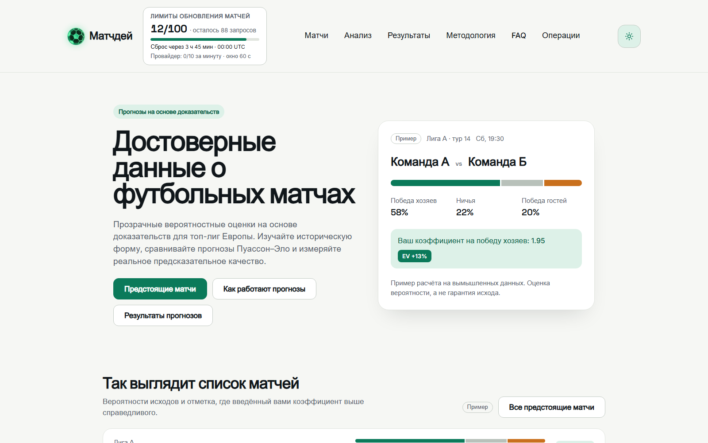
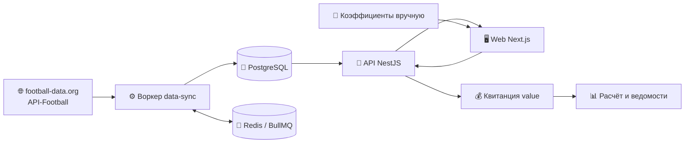
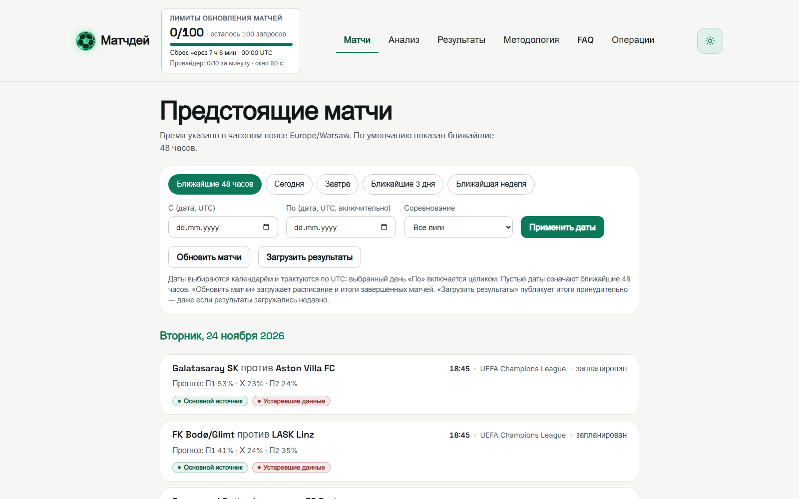
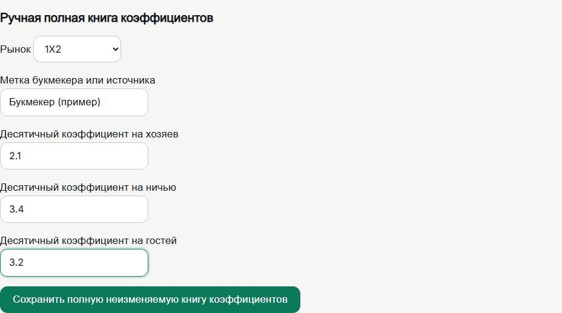
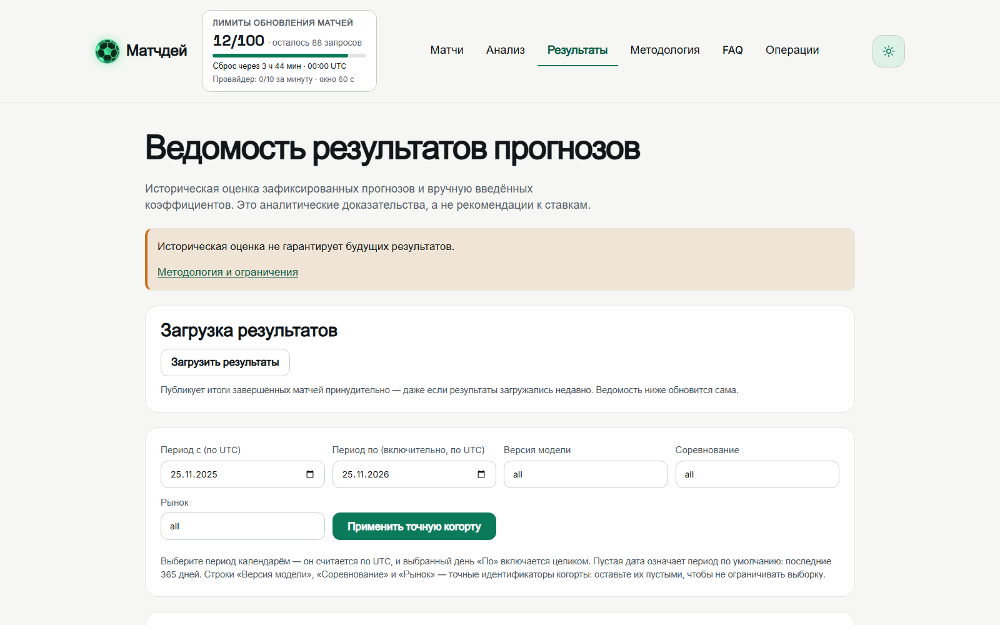
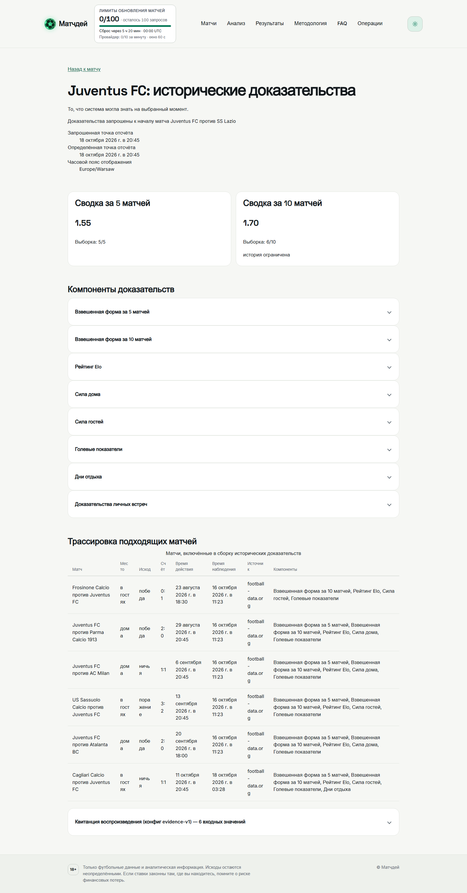
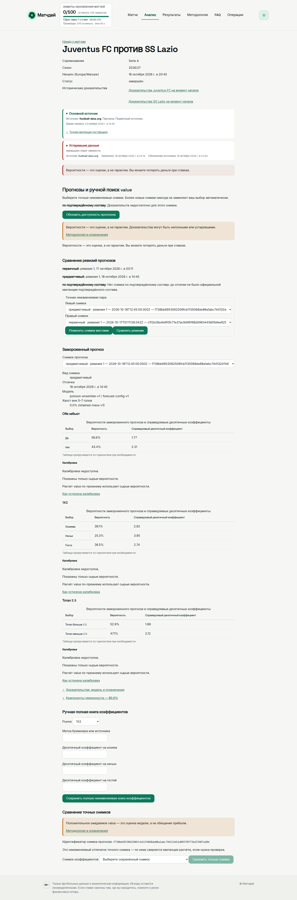
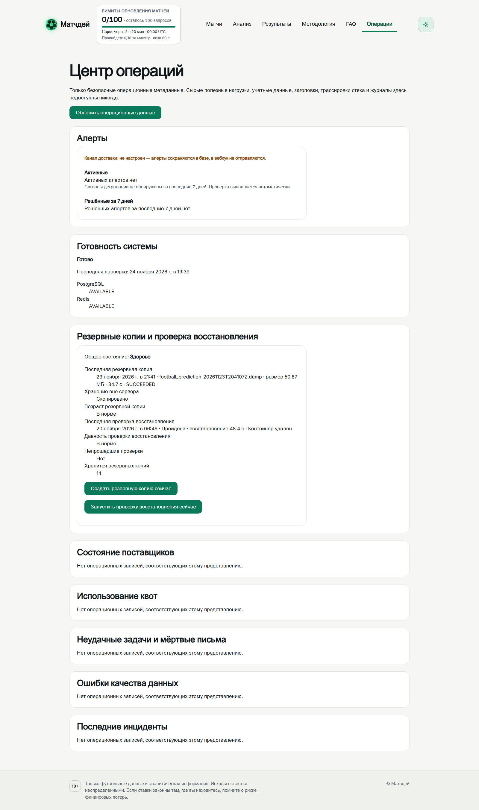

<div align="center">

# ⚽ Матчдей

### Football Prediction & Value Betting Platform

**Честные и воспроизводимые вероятности футбольных событий, качество которых проверяется после каждого матча.**

[](https://github.com/VadyaLegolas/bet-stats/actions/workflows/ci.yml)


[🚀 Запуск](#-быстрый-старт) · [💡 Примеры](#-примеры-использования) · [🗺️ Фазы](#️-фазы-проекта) · [🧪 Проверки](#-проверки) · [📚 Документация](#-документация)



</div>

---

> [!WARNING]
> 🔞 **Только для совершеннолетних и только там, где это разрешено законом.**
> Это аналитика, а **не советы по ставкам**. «Кандидат value» показывает расхождение между оценкой модели и введённым вами коэффициентом, но не обещает прибыль. Ставки несут риск потери денег. Приложение **не размещает ставки**, не подключается к букмекерам и не управляет деньгами.

## 📖 Содержание

- [✨ Возможности](#-возможности)
- [🔄 Как это работает](#-как-это-работает)
- [🗺️ Фазы проекта](#️-фазы-проекта)
- [🧰 Стек и структура](#-стек-и-структура)
- [🚀 Быстрый старт](#-быстрый-старт)
- [💡 Примеры использования](#-примеры-использования)
- [⚙️ Переменные окружения](#️-переменные-окружения)
- [🧪 Проверки](#-проверки)
- [📚 Документация](#-документация)

## ✨ Возможности

| | Возможность | Подробности |
|---|---|---|
| 📅 | **Матчи** | Предстоящие игры по дням, фильтры по периоду и соревнованию, ручное обновление в пределах квоты поставщика |
| 🎯 | **Прогнозы** | Неизменяемые снимки: первичный, предматчевый и по подтверждённому составу |
| 🧮 | **Рынки** | 1X2, тотал 2.5, «обе забьют», азиатский гандикап (от −2.5 до +2.5, шаг 0.25), точный счёт |
| 💰 | **Value** | Ручной ввод коэффициентов, снятие маржи, проверяемые квитанции решений |
| 🔭 | **Сканер** | Кандидаты value на 7 суток вперёд, без ранжирования и пересчёта |
| 📊 | **Оценка качества** | Brier Score, Log Loss, калибровка, CLV, ROI и yield |
| 🔍 | **Доказательства** | Форма, Эло, отдых и личные встречи строго на момент прогноза |
| 🛠️ | **Эксплуатация** | Центр операций, резервные копии с проверкой восстановления, оповещения |

## 🔄 Как это работает



1. 📥 Загружаются матчи и результаты, сущности сопоставляются с каноническими.
2. 🧱 Из истории собираются доказательства без знания будущего.
3. 🎯 Выпускается замороженный прогноз с версией модели и конфигурации.
4. ✍️ Пользователь вводит коэффициенты, система сравнивает их с оценкой.
5. 🏁 После матча прогнозы рассчитываются и попадают в ведомости.

## 🗺️ Фазы проекта

**Прогресс:** 15 из 16 фаз ✅

### 🏁 v1.0 — MVP (завершён)

| Фаза | Название | Что даёт | Статус |
|:---:|---|---|:---:|
| 1️⃣ | 🧭 Trustworthy Fixture Discovery | Матчи с каноническими идентификаторами, происхождением данных и доступом по правилам | ✅ 29.08.2026 |
| 2️⃣ | 🧱 Historical Evidence Pipeline | Повторяемая хронологическая история и признаки команд без утечки из будущего | ✅ 05.09.2026 |
| 3️⃣ | 🎯 Forecast and Manual Value Workbench | Замороженные вероятности, ручные коэффициенты, value или обоснованный отказ | ✅ 08.09.2026 |
| 4️⃣ | 🏆 Settlement and Evidence Scorecard | Расчёт прогнозов и кандидатов, хронологическая оценка качества | ✅ 09.09.2026 |
| 5️⃣ | 🔀 Provider-Aware Coverage and Enrichment | Резервный поставщик и обновление доказательств с видимыми ограничениями | ✅ 20.09.2026 |
| 6️⃣ | 🚢 Release Experience and Operations | Адаптивный интерфейс, методология, операции и приватность | ✅ 01.10.2026 |

### 🔬 v1.1 — надёжность, качество модели и value

| Фаза | Название | Что даёт | Статус |
|:---:|---|---|:---:|
| 7️⃣ | 🤖 CI Pipeline & Quality Gates | Схема, типы, линт, тесты и сборка на каждый push и pull request | ✅ 22.10.2026 |
| 8️⃣ | 💾 Backups and Restore Verification | Резервные копии PostgreSQL с учениями по восстановлению | ✅ 05.11.2026 |
| 9️⃣ | 🚨 Degradation Alerting | Устойчивые оповещения о квотах, воркерах, ошибках 5xx и копиях | ✅ 16.11.2026 |
| 🔟 | ⚡ Performance Audit and Budgets | Бюджеты Lighthouse для страницы матча, регрессии ломают CI | ✅ 17.11.2026 |
| 1️⃣1️⃣ | 📐 Dixon-Coles Model Version | Версионированная поправка на малые счета и сравнение с базовой моделью | ✅ 24.11.2026 |
| 1️⃣2️⃣ | ⚖️ Calibration Layer and Versioned Rollback | Калиброванные вероятности (Platt, isotonic) с откатом при ухудшении | ✅ 24.11.2026 |
| 1️⃣3️⃣ | 📈 CLV Price Diary | Сравнение с ценой закрытия, только для оценки | ✅ 24.11.2026 |
| 1️⃣4️⃣ | ♟️ Asian Handicap and Exact Score Markets | Новые рынки из замороженной матрицы счётов, учёт возвратов | ✅ 25.11.2026 |
| 1️⃣5️⃣ | 🔭 7-Day Value Scanner | Единый список кандидатов с учётом свежести коэффициентов | ✅ 28.11.2026 |
| 1️⃣6️⃣ | 📓 Paper-Trading Journal | Виртуальные сделки: банк, просадка, ROI и yield без реальных ставок | ⏳ запланирована |

Подробности: [дорожная карта v1.1](.planning/ROADMAP.md) и [архив v1.0](.planning/milestones/v1.0-ROADMAP.md).

## 🧰 Стек и структура

| Область | Технологии |
|---|---|
| 🟢 Среда | Node.js 24, pnpm 10.34.5, Turborepo 2, TypeScript 5.9.3 |
| 🖥️ Веб | Next.js 16.3 (App Router), React 19.2 |
| 🧩 API | NestJS 11 на Express |
| 🐘 Данные | PostgreSQL 18, Prisma 7.10 с `@prisma/adapter-pg` |
| 🔴 Очереди | Redis 8, BullMQ 6, Cockatiel |
| 🧮 Расчёты | `decimal.js`, Zod 4 |
| 🧪 Проверки | Vitest 4, Playwright 1.62, ESLint 9, Lighthouse |

```text
📦 bet-stats
├── 📂 apps/
│   ├── 🖥️ web/            # @bet-stats/web: интерфейс и прокси /internal-api/*
│   └── 🧩 api/            # @bet-stats/api: REST API
├── 📂 workers/
│   └── ⚙️ data-sync/      # @bet-stats/data-sync: фоновые задачи
├── 📂 packages/
│   ├── 🧠 domain/         # модели, рынки, value, оценка качества
│   ├── 🐘 database/       # схема Prisma, миграции, репозитории
│   ├── 🔧 config/         # чтение и проверка окружения
│   └── 🌐 football-data/  # адаптеры поставщиков данных
├── 🐳 infra/              # Docker Compose, Dockerfile, шлюз оператора
├── 📜 scripts/            # запуск, сборка, сид, операторские команды
├── 🧪 tests/              # unit, integration, e2e
├── 📚 docs/               # инструкции
└── 🗺️ .planning/          # артефакты планирования
```

> [!NOTE]
> Действующая схема базы: [packages/database/prisma/schema.prisma](packages/database/prisma/schema.prisma). Файл `schema.prisma` в корне — не она.

## 🚀 Быстрый старт

### 📋 Требования

- 🟢 Node.js `>=24.0.0 <25`
- 📦 pnpm `10.34.5` через Corepack (в `.npmrc` включён `engine-strict`)
- 🐳 Docker с Compose v2
- 💻 PowerShell 7 (`pwsh`); сценарий запуска рассчитан на Windows
- 🔑 Токен football-data.org и ключ API-Football для реальных данных

### 1️⃣ Клонирование и зависимости

```powershell
git clone https://github.com/VadyaLegolas/bet-stats.git
```

```powershell
cd bet-stats
```

```powershell
corepack enable
```

```powershell
pnpm install --frozen-lockfile
```

### 2️⃣ Файл `.env`

```powershell
Copy-Item .env.example .env
```

Замените заглушки. Секрет можно сгенерировать так:

```powershell
[Convert]::ToHexString([Security.Cryptography.RandomNumberGenerator]::GetBytes(32)).ToLowerInvariant()
```

Проверьте и заполните эти переменные (шаблон оставляет доступ закрытым):

```dotenv
# Тот же пароль, что и в POSTGRES_PASSWORD
DATABASE_URL=postgresql://football_prediction:<POSTGRES_PASSWORD>@127.0.0.1:5432/football_prediction
# Раскомментируйте строку в .env. Без ключа воркер data-sync не запускает фоновые задачи
API_FOOTBALL_API_KEY=<ваш ключ>
# Доступ к прогнозам, коэффициентам, value, сканеру и ведомостям
ELIGIBILITY_ALLOWED_REGIONS=PL
ELIGIBILITY_REGION=PL
ELIGIBILITY_AGE_ACKNOWLEDGED=true
```

> [!IMPORTANT]
> `PL` здесь пример. Укажите двухбуквенный код своего региона и подтверждайте возраст, только если это правда. Без этих переменных защищённая аналитика отвечает `403` — так задумано. Не коммитьте `.env`.

### 3️⃣ Запуск

```powershell
pwsh -File scripts/app-lifecycle.ps1
```

✨ Сценарий [app-lifecycle.ps1](scripts/app-lifecycle.ps1) загружает `.env`, поднимает PostgreSQL и Redis, собирает проект, применяет миграции, заполняет лиги, запускает web, API, воркер и шлюз оператора, затем открывает браузер. Режим поставщиков — `live`.

| Служба | Адрес |
|---|---|
| 🖥️ Веб-интерфейс | `http://127.0.0.1:3000` |
| 🧩 API | `http://127.0.0.1:3001` |
| 🛡️ Шлюз оператора | `http://127.0.0.1:8080/internal/operations` |
| 🐘 PostgreSQL | `127.0.0.1:5432` |
| 🔴 Redis | `127.0.0.1:6379` |

📄 Логи: `%TEMP%\bet-stats-stack.log` и `%TEMP%\bet-stats-gateway.log`.

### 🎛️ Управление стеком

📟 Состояние:

```powershell
pwsh -File scripts/app-lifecycle.ps1 -Action Status
```

🛑 Остановка приложения:

```powershell
pwsh -File scripts/app-lifecycle.ps1 -Action Stop
```

🐳 Остановка контейнеров:

```powershell
docker compose -f infra/docker-compose.yml --env-file .env down
```

Ключ `-NoBrowser` не открывает браузер. Для двойного щелчка есть `scripts/start-app.bat` и `scripts/stop-app.bat`.

> [!CAUTION]
> Сценарий принудительно завершает процессы на портах 3000 и 3001, если стек на них не отвечает. `-Action Stop` завершает процессы на портах 3000, 3001 и 8080, а также `turbo run dev`.

<details>
<summary>🪜 <b>Запуск по шагам, без сценария</b></summary>

<br>

Приложения не читают корневой `.env` сами: переменные должны быть в окружении терминала. Для реальных данных задайте `DATA_PROVIDER_MODE=live` (по умолчанию `deterministic`) и `REDIS_URL=redis://127.0.0.1:6379`.

```powershell
docker compose -f infra/docker-compose.yml --env-file .env up -d
```

```powershell
pnpm --filter @bet-stats/database exec prisma migrate deploy
```

```powershell
pnpm build
```

```powershell
node scripts/seed-configured-leagues.mjs
```

```powershell
pnpm exec turbo run dev --env-mode=loose
```

Горячая перезагрузка есть только у web. API и воркер запускаются из `dist`.

</details>

<details>
<summary>🛡️ <b>Контейнерное окружение со шлюзом оператора</b></summary>

<br>

```powershell
docker compose -f infra/docker-compose.operator.yml --env-file .env up -d --build
```

Наружу опубликован только порт `8080`. Образ работает с `NODE_ENV=production`, поэтому в `.env` нужны `FOOTBALL_DATA_API_TOKEN` и `API_FOOTBALL_API_KEY`: без них `api` и `worker` не стартуют. Переменные `ELIGIBILITY_*` передаются в контейнеры; пока они не заданы, защищённая аналитика отвечает `403`.

> [!WARNING]
> `api` и `worker` подключены только к внутренней сети Compose без выхода наружу, поэтому запросы к поставщикам данных из этого окружения не проходят.

</details>

## 💡 Примеры использования

### 🧑‍💻 Пример 1. Путь пользователя в интерфейсе

| Шаг | Где | Действие |
|:---:|---|---|
| 1 | 📅 `/fixtures` | Нажмите «Обновить матчи» и выберите период |
| 2 | 🎯 `/fixtures/[fixtureId]` | Откройте матч и выберите снимок прогноза |
| 3 | ✍️ там же | Выберите рынок, введите метку букмекера и все десятичные коэффициенты |
| 4 | 💾 там же | «Сохранить полную неизменяемую книгу коэффициентов» |
| 5 | ⚖️ там же | «Сравнить точные снимки» и прочтите результат проверок |
| 6 | 🔭 `/scanner` | Посмотрите кандидатов на ближайшие 7 суток |
| 7 | 📊 `/scorecards` | После матча нажмите «Загрузить результаты» и оцените калибровку |

<details>
<summary>📸 <b>Снимки экрана</b></summary>

<br>

> Снимки сделаны для встроенного FAQ и могут отличаться от текущего интерфейса.

| 📅 Матчи | ✍️ Коэффициенты |
|:---:|:---:|
|  |  |
| **📊 Ведомость** | **🔍 Доказательства** |
|  |  |
| **🎯 Страница матча** | **🛠️ Центр операций** |
|  |  |

</details>

### 🧮 Пример 2. Как принимается решение value

Правило `value-policy-v1` для трёх основных рынков:

```text
p без маржи = (1 / коэффициент) / сумма (1 / коэффициенты всего рынка)
edge        = p модели − p без маржи          нужно ≥ 0.03
EV          = p модели × коэффициент − 1      нужно ≥ 0.05
confidence  = уверенность прогноза            нужно ≥ 0.65
```

*Числа вымышленные.* Модель оценивает победу хозяев в **48%**, уверенность и качество данных проходят проверки.

| | 📗 Книга А | 📕 Книга Б |
|---|:---:|:---:|
| Коэффициенты П1 / Х / П2 | 2.30 / 3.40 / 3.20 | 2.00 / 3.40 / 3.60 |
| Сумма обратных (с маржой) | 1.0414 | 1.0719 |
| П1 без маржи | 41.75% | 46.65% |
| **Edge** | `+0.0625` ✅ | `+0.0135` ❌ |
| **EV** | `+0.1040` ✅ | `−0.0400` ❌ |
| **Итог** | 🟢 `VALUE_CANDIDATE` | ⚪ `NO_VALUE` |

Если не пройдены проверки уверенности или качества данных, итогом будет 🟡 `INSUFFICIENT_EVIDENCE`. Даже `VALUE_CANDIDATE` — это оценка, а не обещание выигрыша.

### 🔌 Пример 3. Работа с API из PowerShell

Выполняйте блоки по порядку в одном терминале при запущенном стеке.

**🩺 Проверка, квота и список лиг**

```powershell
$api = "http://127.0.0.1:3001"
Invoke-RestMethod "$api/health/live"
Invoke-RestMethod "$api/fixtures/quota"
Invoke-RestMethod "$api/fixtures/leagues"
```

**🔄 Ручная синхронизация (оператор, расходует квоту)**

Задайте `$env:OPERATOR_CREDENTIAL` тем же значением, что в `.env`. Соревнования указываются по названию лиги.

```powershell
Invoke-RestMethod -Method Post "$api/internal/fixtures/sync" -Headers @{ "x-operator-credential" = $env:OPERATOR_CREDENTIAL } -ContentType "application/json" -Body '{"competitions":["Serie A"]}'
```

**📅 Матчи на ближайшие 7 дней** (диапазон не длиннее 31 дня)

```powershell
$now = (Get-Date).ToUniversalTime()
$from = $now.ToString("yyyy-MM-ddTHH:mm:ss.fffZ")
$to = $now.AddDays(7).ToString("yyyy-MM-ddTHH:mm:ss.fffZ")
$fixtures = (Invoke-RestMethod "$api/fixtures?from=$from&to=$to").items
$fixtures | Select-Object id, kickoff, @{n="home";e={$_.teams.home.name}}, @{n="away";e={$_.teams.away.name}}
```

**🎯 Прогнозы матча** (заголовки подтверждения действуют один час; подставьте свой регион)

```powershell
$h = @{ "x-eligibility-region" = "PL"; "x-age-acknowledged" = "true"; "x-eligibility-checked-at" = (Get-Date).ToUniversalTime().ToString("yyyy-MM-ddTHH:mm:ss.fffZ") }
$fixtureId = $fixtures[0].id
$forecasts = Invoke-RestMethod "$api/fixtures/$fixtureId/forecasts" -Headers $h
$forecasts | Select-Object id, kind, cutoff, modelVersion
$forecasts[0].probabilities.ONE_X_TWO
```

Пустой список означает, что воркер ещё не выпустил снимок.

**✍️ Книга коэффициентов** (момент `capturedAt` — до начала матча и не раньше чем за 30 дней)

```powershell
$book = @{
  oddsSnapshotId = "odds-$(New-Guid)"
  market         = "ONE_X_TWO"
  sourceLabel    = "my-bookmaker"
  capturedAt     = (Get-Date).ToUniversalTime().ToString("yyyy-MM-ddTHH:mm:ss.fffZ")
  selections     = @(
    @{ selection = "HOME"; decimalOdds = "2.30" }
    @{ selection = "DRAW"; decimalOdds = "3.40" }
    @{ selection = "AWAY"; decimalOdds = "3.20" }
  )
} | ConvertTo-Json -Depth 4
$odds = Invoke-RestMethod -Method Post "$api/fixtures/$fixtureId/odds" -Headers $h -ContentType "application/json" -Body $book
```

**⚖️ Квитанция value и сканер**

```powershell
$command = @{ fixtureId = $fixtureId; forecastSnapshotId = $forecasts[0].id; oddsSnapshotId = $odds.oddsSnapshotId; market = "ONE_X_TWO"; selection = "HOME" } | ConvertTo-Json
$receipt = Invoke-RestMethod -Method Post "$api/value-receipts" -Headers $h -ContentType "application/json" -Body $command
$receipt
Invoke-RestMethod "$api/value/scanner" -Headers $h
```

> Эти записи неизменяемы и остаются в вашей базе.

### 🗂️ Основные маршруты API

| Метод и путь | Назначение |
|---|---|
| `GET /health/live`, `GET /health/ready` | 🩺 Состояние |
| `GET /fixtures`, `GET /fixtures/:fixtureId` | 📅 Матчи |
| `GET /teams/:teamId/evidence` | 🔍 Доказательства по команде |
| `GET /fixtures/:fixtureId/forecasts` | 🎯 Прогнозы |
| `GET /fixtures/:fixtureId/forecasts/:forecastId/extended-markets` | ♟️ Гандикап и точный счёт |
| `GET`, `POST /fixtures/:fixtureId/odds` | ✍️ Книги коэффициентов |
| `POST /value-receipts`, `GET /value-receipts/:receiptId/download` | 💰 Квитанции |
| `GET /value/scanner` | 🔭 Сканер |
| `GET /evaluation/scorecard`, `GET /evaluation/model-comparison` | 📊 Оценка качества |
| `GET /internal/operations/overview` | 🛠️ Операции (защищено) |

### 📈 Пример 4. Цена закрытия для CLV

Записывается **до начала матча** полным набором выборов. Нужны `pnpm build` и `DATABASE_URL`; `ID_МАТЧА`, метку источника и время замените своими.

```powershell
node scripts/closing-odds.mjs record --fixture ID_МАТЧА --market ONE_X_TWO --source my-bookmaker --observed-at 2026-11-30T11:00:00.000Z --odds HOME=2.10,DRAW=3.40,AWAY=3.60
```

📘 Метка `--source` должна совпадать с `sourceLabel` книги коэффициентов. Подробности: [инструкция оператору](docs/closing-odds-operator.md).

### 🆚 Пример 5. Сравнение версий модели

Нужны `DATABASE_URL`, `REDIS_URL` и запущенный воркер.

```powershell
pnpm model:compare run --from 2026-08-01T00:00:00Z --to 2026-11-01T00:00:00Z
```

### 💾 Пример 6. Резервные копии и оповещения

Добавьте в `.env` и перезапустите стек:

```dotenv
BACKUP_ENABLED=true
# Абсолютный путь
BACKUP_DIR=D:\Backups\bet-stats
BACKUP_RETENTION_COUNT=14
BACKUP_DRILL_INTERVAL_HOURS=168
ALERTS_ENABLED=true
ALERT_WEBHOOK_URL=https://example.com/your-webhook
```

Если утилиты PostgreSQL не установлены на хосте, задайте `PG_BIN` или `BACKUP_PG_CONTAINER`. Копии содержат те же данные, что и база: ограничьте доступ к каталогу.

## ⚙️ Переменные окружения

Шаблон с комментариями: [.env.example](.env.example).

| Переменные | Назначение |
|---|---|
| 🐘 `POSTGRES_PASSWORD` | Пароль в Docker Compose; `POSTGRES_DB`, `POSTGRES_USER`, `POSTGRES_PORT`, `REDIS_PORT` необязательны |
| 🔗 `DATABASE_URL`, `REDIS_URL` | Подключения приложений |
| 🔑 `FOOTBALL_DATA_API_TOKEN`, `API_FOOTBALL_API_KEY` | Поставщики данных |
| 🌐 `DATA_PROVIDER_MODE` | `live` или `deterministic` |
| 📐 `FORECAST_MODEL_VERSION` | `dixon-coles-ensemble-v1` (по умолчанию) или `poisson-ensemble-v1` |
| 🔞 `ELIGIBILITY_ALLOWED_REGIONS`, `ELIGIBILITY_REGION`, `ELIGIBILITY_AGE_ACKNOWLEDGED` | Регион и возраст |
| 🕒 `DISPLAY_TIME_ZONE` | Часовой пояс интерфейса; сценарий по умолчанию берёт `Europe/Warsaw` |
| 🧩 `API_HOST`, `API_PORT`, `API_ORIGIN` | Адрес API, по умолчанию `127.0.0.1:3001` |
| 🛡️ `GATEWAY_PORT`, `WEB_ORIGIN` | Шлюз оператора |
| 👮 `OPERATOR_BASIC_USERNAME`, `OPERATOR_BASIC_PASSWORD`, `OPERATOR_SUBJECT`, `OPERATOR_PROXY_SIGNING_SECRET`, `OPERATOR_AUTHORIZED_SUBJECTS` | Вход оператора и подпись запросов (секрет от 32 символов) |
| 🔐 `OPERATOR_CREDENTIAL` | Заголовок `x-operator-credential` |
| 🕵️ `AUTH_SESSION_SIGNING_SECRET`, `PRIVACY_*`, `DEV_TRUSTED_SESSION_ISSUER` | Конфиденциальность; см. `.env.example` |
| 🩺 `POSTGRES_READY`, `REDIS_READY` | `true` помечает зависимость готовой в `/health/ready` |
| 🚨 `ALERTS_ENABLED`, `ALERT_WEBHOOK_URL`, `ALERTS_TICK_MS`, `ALERTS_WEBHOOK_TIMEOUT_MS` | Оповещения |
| 💾 `BACKUP_ENABLED`, `BACKUP_DIR`, `BACKUP_OFFSITE_DIR`, `BACKUP_RETENTION_COUNT`, `BACKUP_DRILL_INTERVAL_HOURS` | Резервные копии |
| 🧰 `PG_BIN`, `BACKUP_PG_CONTAINER`, `BACKUP_PG_USER`, `BACKUP_PG_DB` | Запуск `pg_dump` |

## 🧪 Проверки

| Команда | Что делает |
|---|---|
| 🔤 `pnpm typecheck` | Проверка типов |
| 🧹 `pnpm lint` | ESLint |
| ⚡ `pnpm test` | Unit-тесты и тесты веб-приложения |
| 🐳 `pnpm test:integration:docker` | Интеграционные тесты с временными PostgreSQL и Redis |
| 🔗 `pnpm test:integration` | Те же тесты на подготовленном вами окружении |
| 🎭 `pnpm test:e2e` | Playwright; порты 3000 и 3001 должны быть свободны. Часть спецификаций использует другие конфигурации `playwright.*.config.ts` |
| 🔭 `pnpm verify:scanner` | E2E сканера на заглушке API, порты 3251 и 3252 |
| 🚢 `pnpm verify:release` | Выпускной прогон: окружение, установка, схема, типы, тесты, сборка, E2E и сканер (без линта) |
| 🏗️ `pnpm build` | Сборка всех пакетов |

Перед тестами на чистом клоне выполните `pnpm build`. Браузер для E2E устанавливается один раз:

```powershell
pnpm exec playwright install chromium
```

🤖 [CI](.github/workflows/ci.yml) на push в `main` и pull request запускает задания `quality`, `integration`, `e2e-portable` и `performance-budget`.

## 📚 Документация

| Документ | Содержание |
|---|---|
| 📘 [Коэффициенты закрытия](docs/closing-odds-operator.md) | Инструкция оператору |
| 📄 [SPEC.md](SPEC.md) | Исходная спецификация (англ.) |
| 🏛️ [ARCHITECTURE.md](ARCHITECTURE.md) | Исходная архитектурная схема |
| 🗂️ [MONOREPO_STRUCTURE.md](MONOREPO_STRUCTURE.md) | Рекомендованная на старте структура |
| 🇷🇺 [Спецификация на русском](football-prediction-spec/ru/) | Русская версия исходных документов |
| 🎯 [PROJECT.md](.planning/PROJECT.md) | Цели, ограничения, решения |
| ✅ [REQUIREMENTS.md](.planning/REQUIREMENTS.md) | Требования |
| 🗺️ [ROADMAP.md](.planning/ROADMAP.md) | Дорожная карта |
| 📏 [AGENTS.md](AGENTS.md), [CONVENTIONS.md](CONVENTIONS.md) | Интерфейс на русском, идентификаторы и коммиты на английском |

---

<div align="center">

⚽ **Матчдей** — вероятности, а не обещания.

🔞 18+ · Играйте ответственно или не играйте вовсе.

</div>
